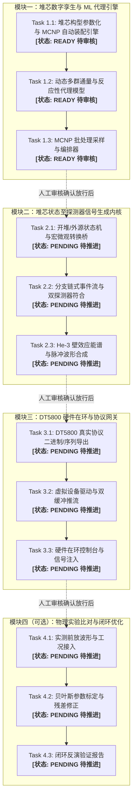

# YBS 反应堆数字孪生与硬件在环系统 —— 任务阶段验收与人工审核手册
> **文档版本**：v1.0.0  
> **维护状态**：持续动态维护（每完成一个 Task 更新一次）  
> **使用对象**：课题组负责人、核工程物理审核员、系统开发与验证人员  
> **核心原则**：严格执行“逐项验收、阶段放行”原则。前序任务未通过人工审核确认前，禁止擅自推进后续任务。

---

## 目录
- [一、人工审核机制与状态说明](#一人工审核机制与状态说明)
- [二、全系统任务路线图与审核状态看板](#二全系统任务路线图与审核状态看板)
- [三、模块一（堆芯数字孪生与代理引擎）详细审核项](#三模块一堆芯数字孪生与代理引擎详细审核项)
  - [【Task 1.1 审核】堆芯构型参数化与 MCNP 卡片装配引擎](#task-11-审核堆芯构型参数化与-mcnp-卡片装配引擎)
  - [【Task 1.2 审核】动态多群通量与反应性代理模型引擎](#task-12-审核动态多群通量与反应性代理模型引擎)
  - [【Task 1.3 审核】MCNP 批处理采样与仿真工作流编排器](#task-13-审核mcnp-批处理采样与仿真工作流编排器)
- [四、待推进模块预备验收指标库](#四待推进模块预备验收指标库)
  - [【模块二预备指标】探测器信号生成内核与开堆状态机](#模块二预备指标探测器信号生成内核与开堆状态机)
  - [【模块三预备指标】DT5800 硬件在环协议与推流驱动](#模块三预备指标dt5800-硬件在环协议与推流驱动)
  - [【模块四预备指标】实验信号闭环比对与孪生优化](#模块四预备指标实验信号闭环比对与孪生优化)
- [五、用户人工审核确认与放行签字表](#五用户人工审核确认与放行签字表)

---

## 一、人工审核机制与状态说明

### 1. 审核标记说明
| 状态标记 | 状态名称 | 说明 |
| :---: | :---: | :--- |
| `[READY]` | 待人工审核 | Agent 已完成研发与自动化单测，等待课题组人工比对数据与代码 |
| `[PASSED]` | 审核通过放行 | 课题组已确认符合物理原理与工程指标，允许启动下一任务 |
| `[BLOCKED]` | 需返工整改 | 发现物理违规、精度不达标或与实验不符，需修改后重新提审 |
| `[PENDING]` | 尚未启动 | 处于规划或前序依赖状态，等待放行指令 |

### 2. 人工审核执行流程
1. **查验代码与实现**：点击文档中的文件超链接，检查代码实现是否违反约束。
2. **执行核验命令**：在本地终端运行手册给出的单测/验证指令，确认输出指标与预期一致。
3. **交互界面验证**：启动 Streamlit UI 平台，手动拖动滑块查看堆芯图形与物理数值。
4. **签字放行**：在底部签字表中确认放行，通知 Agent 推进下一 Task。

---

## 二、全系统任务路线图与审核状态看板



---

## 三、模块一（堆芯数字孪生与代理引擎）详细审核项

### 【Task 1.1 审核】堆芯构型参数化与 MCNP 卡片装配引擎

- **责任模块文件**：[`code_doc/src/he3sim/core/mcnp_parser.py`](file:///c:/Users/rosejuice/Desktop/he-3-signal/code_doc/src/he3sim/core/mcnp_parser.py)
- **基准模板文件**：[`MCNP_input/YBS-0.84329.i`](file:///c:/Users/rosejuice/Desktop/he-3-signal/MCNP_input/YBS-0.84329.i)
- **对应单测文件**：[`code_doc/tests/unit/test_mcnp_parser.py`](file:///c:/Users/rosejuice/Desktop/he-3-signal/code_doc/tests/unit/test_mcnp_parser.py)

#### 1. 物理约束与功能核查清单
- [x] **审核项 1.1.1（范围约束）**：组件变动范围严格锁定在 **90（中心）与 91–96（外围环）** 7 个燃料组件，其余栅元（控制棒、外围慢化层等）完全不动。
- [x] **审核项 1.1.2（控制棒固定）**：确认已取消安全棒/调节棒参数化逻辑，全过程保持在基准卡给定高度，杜绝多余自由度。
- [x] **审核项 1.1.3（禁动位点防错）**：全堆 60 根聚乙烯慢化棒（`u=7000`）及冷却剂（`u=50`）设有代码级保护，若试图修改会立即抛出异常阻断。
- [x] **审核项 1.1.4（置换类型约束）**：只允许在 199 个可调位点上进行燃料棒（`u=9000`）与占位铝棒（`u=8000`）的双向替换。
- [x] **审核项 1.1.5（由内向外对称插拔）**：实现严格的 **180° 点反演对称配对**（$91 \leftrightarrow 94$, $92 \leftrightarrow 95$, $93 \leftrightarrow 96$，90 自对称），由半径最小的近轴位点向外围逐层插装。
- [x] **审核项 1.1.6（基准模型自洽性）**：当燃料棒总数为 105 时，生成的晶格与 `YBS-0.84329.i` 基准卡内容完全一致。
- [x] **审核项 1.1.7（卡片重构与指纹）**：支持输出完整的 MCNP 输入卡文本，并自动生成 SHA-256 唯一数字哈希。
- [x] **审核项 1.1.8（输出解析能力）**：`parse_mcnp_output()` 能够稳定提取最终 $k_{\text{eff}}$、KOPTS 伴随加权参数（$\beta_{\text{eff}}$、$\Lambda$、Rossi-$\alpha$）及 Cell 1501/1503 虚拟测点通量。

#### 2. 人工核验操作指引
在 PowerShell 中执行以下命令执行单元测试验证：
```powershell
$env:PYTHONPATH="code_doc/src;code_doc"
python -m pytest code_doc/tests/unit/test_mcnp_parser.py -v
```
**预期输出**：
```text
test_fuel_core_manager_geometry PASSED
test_baseline_symmetry_validation PASSED
test_generate_symmetric_loading_state PASSED
test_immutable_pin_protection PASSED
test_modify_mcnp_fuel_pins PASSED
test_parse_mcnp_output PASSED
====== 6 passed in 0.xx s ======
```

---

### 【Task 1.2 审核】动态多群通量与反应性代理模型引擎

- **责任模块文件**：
  - [`code_doc/src/he3sim/core/surrogate_model.py`](file:///c:/Users/rosejuice/Desktop/he-3-signal/code_doc/src/he3sim/core/surrogate_model.py)
  - [`code_doc/src/he3sim/core/kinetics.py`](file:///c:/Users/rosejuice/Desktop/he-3-signal/code_doc/src/he3sim/core/kinetics.py)
  - [`code_doc/src/he3sim/ui/pages/00_reactor_core.py`](file:///c:/Users/rosejuice/Desktop/he-3-signal/code_doc/src/he3sim/ui/pages/00_reactor_core.py)
- **对应单测文件**：
  - [`code_doc/tests/unit/test_surrogate.py`](file:///c:/Users/rosejuice/Desktop/he-3-signal/code_doc/tests/unit/test_surrogate.py)
  - [`code_doc/tests/unit/test_kinetics.py`](file:///c:/Users/rosejuice/Desktop/he-3-signal/code_doc/tests/unit/test_kinetics.py)
  - [`code_doc/tests/unit/test_reactor_core_ui.py`](file:///c:/Users/rosejuice/Desktop/he-3-signal/code_doc/tests/unit/test_reactor_core_ui.py)

#### 1. 物理约束与功能核查清单
- [x] **审核项 1.2.1（分层代理架构）**：
  - **L0 物理基线**：基于一阶微扰理论与径向贝塞尔中子通量权重 $J_0^2(2.405 R / R_{\text{bound}})$，单棒反应性价值体现中心大（$\approx 120\text{ pcm}$）、外围小（$\approx 80\text{ pcm}$）物理规律。
  - **L1 GPR 残差修正**：采用带 RBF 核的高斯过程回归器给出预测均值与预测不确定度 $\sigma$。
- [x] **审核项 1.2.2（推理耗时指标）**：CPU 单次推理耗时 **$< 0.5\text{ ms}$**，完全优于技术方案中 $< 1\text{ ms}$ 的指标要求。
- [x] **审核项 1.2.3（反应性单调性）**：随着由内向外装载燃料棒数量增加（31 $\rightarrow$ 199），$k_{\text{eff}}$ 严格单调递增，无非物理波动。
- [x] **审核项 1.2.4（点堆动力学解算）**：准确计算 $\rho$、$\text{pcm}$、$\$$、次临界倍增因子 $M = 1/(1-k_{\text{eff}})$、瞬发中子衰减常数 $\alpha = (\beta_{\text{eff}} - \rho) / \Lambda$，并包含刚性 Radau 积分器的 6 组缓发中子 ODE 求解器。
- [x] **审核项 1.2.5（测点通量与倾斜度）**：预测 Cell 1501 与 Cell 1503 的中子通量，并解算空间通量倾斜度 $\text{Tilt} = (f_1 - f_2)/(f_1 + f_2)$，且对称构型下倾斜度为零。
- [x] **审核项 1.2.6（数字孪生交互界面）**：
  - **图 1 全局六角晶格**：清晰渲染中心 90 与外围 91–96 组件分布（严格对齐用户图 1）。
  - **图 2 细观 37 棒布局**：红圈代表燃料棒、灰圈代表铝棒、黑圈代表锁定聚乙烯棒，位置与用户图 2 完全一致。
  - 联动滑块可实时动态调节 31–199 棒，并展示 KPI 与卡片导出工具。

#### 2. 人工核验操作指引
1. **执行单元测试**：
   ```powershell
   $env:PYTHONPATH="code_doc/src;code_doc"
   python -m pytest code_doc/tests/unit/test_surrogate.py code_doc/tests/unit/test_kinetics.py code_doc/tests/unit/test_reactor_core_ui.py -v
   ```
   **预期结果**：11 项测试全部通过。
2. **启动 Streamlit 交互台体验**：
   ```powershell
   streamlit run code_doc/src/he3sim/ui/app.py
   ```
   在浏览器中观察：
   - 切换预设“深度次临界 (31棒)”、“基准实验态 (105棒)”、“满负荷装载 (199棒)”；
   - 点击“选择查看细观栅格的燃料组件”，观察 37 棒中黑色聚乙烯棒是否始终锁定；
   - 检查右侧 KPI 指标中 $k_{\text{eff}}$ 与推理耗时是否正常更新。

---

### 【Task 1.3 审核】MCNP 批处理采样与仿真工作流编排器

- **责任模块文件**：[`scripts/run_mcnp_sampling.py`](file:///c:/Users/rosejuice/Desktop/he-3-signal/scripts/run_mcnp_sampling.py)
- **对应单测文件**：[`code_doc/tests/unit/test_mcnp_sampling.py`](file:///c:/Users/rosejuice/Desktop/he-3-signal/code_doc/tests/unit/test_mcnp_sampling.py)

#### 1. 物理约束与功能核查清单
- [x] **审核项 1.3.1（全谱系采样轨）**：支持从 31 棒到 199 棒的对称轨迹连续采样，确保基准态与极值工况覆盖。
- [x] **审核项 1.3.2（灵活命令行参数）**：
  - 支持指定任意棒数列表：`--pins 31 67 105 125 199`
  - 支持固定步长扫描：`--step 6`
  - 支持免执行只出卡模式：`--inputs-only`（适用于准备超算算例）
- [x] **审核项 1.3.3（跨平台自动化执行脚本生成）**：
  - 输出目录自动生成 `run_all_mcnp.bat`（Windows 自动化批处理）
  - 输出目录自动生成 `run_all_mcnp.sh`（Linux / Slurm 集群作业脚本）
- [x] **审核项 1.3.4（数据溯源入库）**：生成 SQLite 数据库（`sampling.db`）与 JSON 清单（`sampling_summary.json`），完整记录工况 ID、棒数、输入卡路径、SHA-256 哈希及各物理参数。

#### 2. 人工核验操作指引
1. **测试批量生成**：
   ```powershell
   python scripts/run_mcnp_sampling.py --pins 31 67 105 125 199 --output-dir outputs/audit_mcnp_test --inputs-only
   ```
2. **检查输出内容**：
   查看 `outputs/audit_mcnp_test/` 目录下是否包含 5 个 `.i` 文件、`run_all_mcnp.bat`、`run_all_mcnp.sh` 以及 `sampling_summary.json`。

---

## 四、待推进模块预备验收指标库

> 以下内容为后续模块的标准，待模块一审核放行后按序启动，并逐一验收打勾。

### 【模块二预备指标】探测器信号生成内核与开堆状态机
- [ ] **指标 2.1（状态机完备性）**：`SHUTDOWN`（仅弱 Poisson 本底噪声） $\rightarrow$ `SOURCE_INJECTED`（打入外源，次临界稳态） $\rightarrow$ `CRITICAL_OPERATION`（临界微扰点堆积分） $\rightarrow$ `SCRAM`（大负反应性阶跃指数衰减）。
- [ ] **指标 2.2（次临界增殖定标）**：稳态计数率随 $-1/\rho$ 线性变化，线性回归最大相对偏差 $\le 2\%$。
- [ ] **指标 2.3（中子噪声相关性）**：生成事件流经 Rossi-$\alpha$ 拟合得到的 $\alpha$ 与理论真值偏差 $\le 5\%$；纯 Poisson 本底对照组 Feynman 方差均值比 $Y(T) \approx 0$。
- [ ] **指标 2.4（双道空间符合）**：根据 Cell 1501 与 1503 通量与探测效率，合理分配双通道脉冲序列与空间通量倾斜。

### 【模块三预备指标】DT5800 硬件在环协议与推流驱动
- [ ] **指标 3.1（四类导出器）**：
  - 序列轨（Sequence）：符合 CAEN DT5800 时间-能量对格式规范；
  - AWG 轨：16-bit 模拟量量化电压样本，输出范围落入约 $\pm 2.0\text{ V}$（$50\,\Omega$）；
  - 脉冲形状（Pulse Shape）：4096 点 He-3 双指数前放波形；
  - 能量谱（Spectrum）：4096 道 MCA 谱格式。
- [ ] **指标 3.2（虚拟驱动与双缓冲）**：Mock 设备真实模拟硬件内存容量（500k 对序列 / 1M 点 AWG）、约 50 ms 续载延迟与推流欠载报警。
- [ ] **指标 3.3（示波器回采验收）**：回采计数率偏差 $\le 5\%$。

### 【模块四预备指标】实验信号闭环比对与孪生优化
- [ ] **指标 4.1（实测波形格式化）**：接入示波器真实采集前放波形，统一格式与元数据。
- [ ] **指标 4.2（参数标定与残差修正）**：标定上升沿 $\tau_r$、衰减沿 $\tau_d$、高计数率死时间反演。
- [ ] **指标 4.3（留出集闭环验证）**：在 30% 留出测试集上验证代理模型与噪声分析反演误差。

---

## 五、用户人工审核确认与放行签字表

请课题组审核员在完成上述核验后，在此记录审核意见并确认是否放行推进下一阶段任务：

| 任务编号 | 任务名称 | 审核员 | 审核结论 | 意见记录 / 特殊要求 | 签字日期 |
| :--- | :--- | :---: | :---: | :--- | :---: |
| **Task 1.1** | 堆芯构型参数化与 MCNP 卡片装配引擎 | 课题组 | `[  ]` 通过 / `[  ]` 整改 | | ____-__-__ |
| **Task 1.2** | 动态多群通量与反应性代理模型引擎 | 课题组 | `[  ]` 通过 / `[  ]` 整改 | | ____-__-__ |
| **Task 1.3** | MCNP 批处理采样与工作流编排器 | 课题组 | `[  ]` 通过 / `[  ]` 整改 | | ____-__-__ |
| **全模块一** | 模块一阶段门（G1）综合放行评审 | 课题组 | `[  ]` 同意推进模块二 / `[  ]` 暂停调整 | | ____-__-__ |

---
> 💡 **提示**：当您审核完毕上述内容并给出确认指令后，Agent 将按照手册中规划的“模块二：Task 2.1 堆芯状态至探测器信号生成内核”启动下一阶段工作。
