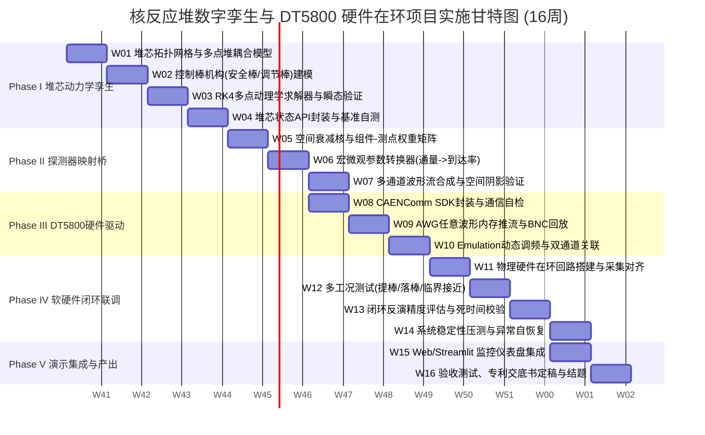

# 核反应堆数字孪生与 DT5800 硬件在环系统项目详细实施计划表

> **项目名称**：核反应堆宏观数字孪生与 He-3 探测器脉冲信号硬件在环（HIL）闭环测试系统  
> **制定时间**：2026年10月  
> **实施周期**：16周（4个月）  
> **计划属性**：工程实施主干计划、工作分解结构（WBS）、里程碑与交付验收标准  

---

## 一、项目实施总体节奏与甘特图

本项目划分为 **5 个主要阶段（Phase I ~ Phase V）**，共计 16 周。各阶段采用紧密咬合的双周迭代（Sprint）推进模式，设置 5 个强制性评审决策门（Gate 0 ~ Gate 4），确保“软件先行、硬体验证、全链闭环、成果沉淀”。



---

## 二、工作分解结构（WBS）与周度任务清单

### Phase I：堆芯宏观动力学数字孪生引擎（第 1 ~ 4 周）
**阶段目标**：建立轻量、稳定、毫秒级实时的堆芯物理多点动力学求解器，完整支持组件网格布局、安全棒紧急落棒与调节棒步进高度调节。

| 周次 | 核心任务模块 | 详细任务内容 (Tasks) | 责任角色 | 交付物 (Deliverables) |
|---|---|---|---|---|
| **W01** | 堆芯拓扑与多点几何 | 1. 定义 $3 \times 3$ / $5 \times 5$ 组件方形及六角形网格拓扑数据结构；<br>2. 建立各组件宏观裂变、吸收截面基值字典；<br>3. 确定多点堆中子交换耦合概率矩阵 $C_{mj}$。 | 物理算法工程师 | `he3sim/core/geometry.py`<br>`he3sim/core/cross_sections.py` |
| **W02** | 控制棒驱动机构 (CRDM) | 1. 建立安全棒重力加速落棒动力学模型（全程约 1.8 s）；<br>2. 建立调节棒步进电机驱动与正弦平方轴向微分棒位价值模型；<br>3. 棒位到位检测与积分“S”曲线反应性计算。 | 软件架构师 | `he3sim/core/control_rods.py`<br>`tests/unit/test_rods.py` |
| **W03** | 多点堆动力学求解器 | 1. 编写包含 6 组缓发先驱核的 MPKE 微分方程组；<br>2. 采用四阶 Runge-Kutta（RK4）方法在 1 ms 步长下实时求解；<br>3. 实现稳态自平衡校验与外中子源驱动平衡点初始化。 | 物理算法工程师 | `he3sim/core/kinetics_solver.py`<br>`tests/unit/test_kinetics.py` |
| **W04** | 核心状态机与阶段门 Gate 1 | 1. 封装 `ReactorCore` 核心对外统一 API 接口；<br>2. 验证落棒、连续提棒阶跃响应曲线与经典点堆解析解对比；<br>3. 阶段门 Gate 1 评审与单步耗时压测（$<0.2\text{ ms}$）。 | 全体团队 | `he3sim/core/reactor_twin.py`<br>Phase I 性能与物理验证报告 |

---

### Phase II：堆芯-探测器物理映射桥与波形生成（第 5 ~ 7 周）
**阶段目标**：建立空间宏观通量到微观中子到达率的传输映射核，实现多通道微观波形流合成与空间阴影效应。

| 周次 | 核心任务模块 | 详细任务内容 (Tasks) | 责任角色 | 交付物 (Deliverables) |
|---|---|---|---|---|
| **W05** | 空间传输权重核 | 1. 建立组件到堆外/堆内测点的空间几何衰减权重矩阵 $W_{kj}$；<br>2. 支持对称布置（东侧 Det-1、西侧 Det-2）等多测点网络配置；<br>3. 计算局部通量倾斜（Flux Tilt）与测点空间阴影效应。 | 物理算法工程师 | `he3sim/physics/spatial_weighting.py`<br>测点权重系数配置文件 |
| **W06** | 宏微观参数转换器 | 1. 将测点通量动态转换为 He-3 探测器真实到达率 $\lambda_{\text{true}}(t)$；<br>2. 将全局反应性实时转化为瞬发中子衰减常数 $\alpha(t)$；<br>3. 打通参数到 `BranchingProcessGenerator` 的无缝流式传递。 | 软件架构师 | `he3sim/physics/detector_bridge.py`<br>`tests/unit/test_bridge.py` |
| **W07** | 多通道波形合成与 Gate 2 | 1. 生成多测点独立的连续模拟电压波形 $V_k(t)$；<br>2. 叠加 He-3 壁效应能谱、双指数脉冲内核与带限噪声；<br>3. 验证单侧调棒时双通道信号的非对称幅度响应；<br>4. 阶段门 Gate 2 评审：波形统计特征与空间效应验收。 | 全体团队 | `he3sim/synthesis/multi_channel.py`<br>Phase II 信号映射验证报告 |

---

### Phase III：CAEN DT5800 硬件驱动与推流链（第 8 ~ 10 周）
**阶段目标**：打通 PC 上位机到 CAEN DT5800 硬件的底层驱动，实现 AWG 模式波形输出与 Emulation 动态流式调频。

| 周次 | 核心任务模块 | 详细任务内容 (Tasks) | 责任角色 | 交付物 (Deliverables) |
|---|---|---|---|---|
| **W08** | 通信适配层开发 | 1. 基于 Python `ctypes` 封装官方 `CAENComm` / `DT5800 SDK`；<br>2. 实现 USB 2.0 / 虚拟串口设备的自动枚举、连接握手与心跳；<br>3. 编写设备通信自检与固件兼容性诊断脚本。 | 硬件测试工程师 | `he3sim/hil/dt5800_comm.py`<br>`scripts/diagnose_dt5800.py` |
| **W09** | AWG 任意波形回放 | 1. 编写波形数据格式化工具（14-bit DAC 整数映射与电压量程适配）；<br>2. 实现 1 MSamples/通道深度内存的高效分块推流；<br>3. 示波器回采物理 BNC 输出，校准幅值与时钟抖动。 | 硬件测试工程师<br>软件架构师 | `he3sim/hil/awg_player.py`<br>示波器回采与校准曲线 |
| **W10** | Emulation 流式调频与 Gate 3 | 1. 导出 He-3 能谱直方图与双指数形状文件至 DT5800 存储区；<br>2. 建立上位机以 20~50 Hz 频率动态推送到达率 $\lambda(t)$ 的通信通道；<br>3. 配置 DT5800D 双通道关联模式输出；<br>4. 阶段门 Gate 3 评审：物理脉冲输出稳定性与双通道同步性验收。 | 全体团队 | `he3sim/hil/emulator_streamer.py`<br>Phase III 硬件驱动测试报告 |

---

### Phase IV：软硬件全闭环联调与多工况反演（第 11 ~ 14 周）
**阶段目标**：连接真实采集仪器形成物理闭环，执行典型核反应堆运行工况测试，验证全链条反演精度。

| 周次 | 核心任务模块 | 详细任务内容 (Tasks) | 责任角色 | 交付物 (Deliverables) |
|---|---|---|---|---|
| **W11** | 闭环物理测试台搭建 | 1. 搭建拓扑：上位机 $\rightarrow$ DT5800 $\rightarrow$ 真实示波器/数字化仪 $\rightarrow$ 采集导入；<br>2. 统一触发时钟，建立采集波形自动归档与元数据关联流水线；<br>3. 消除接地环路干扰、阻抗不匹配反射与电子学基线偏移。 | 硬件测试工程师 | 硬件在环测试台硬件接线规范<br>`he3sim/hil/daq_importer.py` |
| **W12** | 经典反应堆工况测试 | 1. **工况 1**：稳态次临界源驱动（不同次临界深度 $\rho = -0.5\$ \sim -3.0\$$）；<br>2. **工况 2**：调节棒连续阶跃提棒与功率倍增瞬态；<br>3. **工况 3**：安全棒急停脱扣（Scram）落棒负反应性停堆瞬态。 | 物理算法工程师<br>硬件测试工程师 | 3 类典型工况实测数据集<br>波形与时序特征记录表 |
| **W13** | 闭环反演精度评估 | 1. 运行 `he3sim.analysis`（Rossi-$\alpha$、Feynman-$\alpha$、PSD 反演）；<br>2. 将硬件回采反演得到的 $\alpha$、$\rho$ 与 Phase I 设定的物理真值比对；<br>3. 评估堆积与死时间在不同计数率下的测量偏置。 | 物理算法工程师 | `he3sim/analysis/hil_validation.py`<br>真值比对与误差分析报告 |
| **W14** | 压力测试与 Gate 4 | 1. 开展连续 8 小时不间断推流与采集稳定性测试；<br>2. 模拟通信中断、参数越界等异常场景的容错与安全复位机制；<br>3. 阶段门 Gate 4 评审：闭环误差指标达标（$\alpha$ 误差 $<5\%$）。 | 全体团队 | 系统健壮性测试报告<br>Gate 4 阶段评审决议书 |

---

### Phase V：演示集成、知识产权与交付归档（第 15 ~ 16 周）
**阶段目标**：整合端到端可视化监控仪表盘，完成技术文档归档、发明专利交底书定稿与项目验收总结。

| 周次 | 核心任务模块 | 详细任务内容 (Tasks) | 责任角色 | 交付物 (Deliverables) |
|---|---|---|---|---|
| **W15** | 综合可视化仪表盘 | 1. 升级 Streamlit 前端：三维/二维组件网格通量图、控制棒高度滑块；<br>2. 实时曲线：全局功率、$\rho(t)$、测点计数率与示波器回采波形同步刷新；<br>3. 嵌入一键急停（Scram）与预设工况脚本执行功能。 | 软件架构师 | `he3sim/ui/dashboard.py`<br>一键启动脚本与操作指南 |
| **W16** | 知识产权与验收交付 | 1. 编制第二项发明专利交底书（《基于多点动理学与探测器模拟器的硬件在环测试系统》）；<br>2. 撰写高水平学术期刊论文初稿；<br>3. 召开项目最终验收结题汇报会，全套软件与文档交付。 | 全体团队 | 发明专利交底书定稿<br>顶级期刊论文初稿<br>项目验收总结与结题报告 |

---

## 三、里程碑决策门（Decision Gates）与验收指标

为规避研发风险，项目设立 **5 个强制性评审决策门**：

```
+───────────────────────────────────────────────────────────────────────────+
| [Gate 0] 方案评审 (W00)  -> 架构方案确认、软硬件接口规范定稿               |
|                                     │                                     |
|                                     ▼                                     |
| [Gate 1] 堆芯动力学门 (W04) -> MPKE 求解耗时 < 0.2 ms，物理响应自洽       |
|                                     │                                     |
|                                     ▼                                     |
| [Gate 2] 信号映射门 (W07)  -> 空间阴影效应显著，多通道波形流生成稳定     |
|                                     │                                     |
|                                     ▼                                     |
| [Gate 3] 硬件推流门 (W10)  -> DT5800 稳定物理输出，双通道时钟抖动 < 1 ns  |
|                                     │                                     |
|                                     ▼                                     |
| [Gate 4] 全闭环验收门 (W14) -> 物理回采反演 alpha 误差 < 5%，8h 连续无故障 |
+───────────────────────────────────────────────────────────────────────────+
```

### 决策门详细准出指标定义

| 决策门 | 评审节点 | 核心准出指标（Pass Criteria） | 未达标预案（Fall-back Strategy） |
|---|---|---|---|
| **Gate 1** | 第 4 周末 | 1. 堆芯动力学单步求解耗时 $\le 0.2\text{ ms}$；<br>2. 稳态中子注量率守恒相对误差 $\le 10^{-5}$；<br>3. 阶跃反应性插入渐近行为与经典点堆解析解一致。 | 若 Python 原生求解性能不足，改用 Numba JIT 或 C++ 动态库加速求解内核。 |
| **Gate 2** | 第 7 周末 | 1. 单侧调节棒移动时，对称测点通量比值畸变（倾斜）$\ge 15\%$；<br>2. 离散事件流向连续波形转换不丢脉冲，峰值幅度保真度 $\ge 98\%$。 | 重新校正空间衰减权重矩阵系数，精细化网格距离分步计算。 |
| **Gate 3** | 第 10 周末 | 1. DT5800 USB 通信无重连丢失，AWG 写入无坏点；<br>2. Emulation 模式到达率刷新延迟 $\le 50\text{ ms}$；<br>3. 物理 BNC 输出电压幅度与软件目标偏差 $\le 2\%$。 | 若动态推流存在 USB 延迟，改用硬件内部序列预加载触发机制。 |
| **Gate 4** | 第 14 周末 | 1. 示波器回采波形经 Rossi-$\alpha$ / Feynman-$\alpha$ 反演出的 $\alpha$ 相对误差 $\le 5\%$；<br>2. 系统连续运行 8 小时无内存泄漏与死锁。 | 增加波形数字滤波与前置放大器基线自适应校正补偿。 |

---

## 四、团队职责与 RACI 矩阵

- **R（Responsible，执行者）**：负责直接完成任务的具体产出；
- **A（Accountable，终责者）**：对成果质量负最终法律/科学责任（项目负责人）；
- **C（Consulted，咨询者）**：提供专业理论与技术支持的角色；
- **I（Informed，知情者）**：需被通知进展与结果的角色。

| WBS 任务模块 | 物理算法工程师 | 软件架构师 | 硬件测试工程师 | 项目负责人 |
|---|:---:|:---:|:---:|:---:|
| 1.1 堆芯拓扑与多点动力学方程建模 | **R** | C | I | **A** |
| 1.2 控制棒机构与落棒动力学实现 | C | **R** | I | **A** |
| 1.3 核心求解器数值优化与自测 | **R** | R | I | **A** |
| 2.1 空间传输核与权重矩阵开发 | **R** | C | I | **A** |
| 2.2 宏微观参数转换器与波形接口 | C | **R** | I | **A** |
| 2.3 多通道波形流生成与阴影测试 | **R** | R | C | **A** |
| 3.1 CAEN SDK 封装与底层驱动开发 | I | C | **R** | **A** |
| 3.2 AWG 模式波形格式与推流开发 | I | **R** | R | **A** |
| 3.3 Emulation 模式流式调频实现 | C | R | **R** | **A** |
| 4.1 物理测试台搭建与信号调理 | I | I | **R** | **A** |
| 4.2 典型反应堆工况闭环测试 | **R** | C | R | **A** |
| 4.3 闭环反演精度评估与报告撰写 | **R** | C | C | **A** |
| 5.1 综合交互式监控仪表盘开发 | C | **R** | C | **A** |
| 5.2 发明专利交底书定稿与结题交付 | **R** | R | R | **A** |

---

## 五、风险识别与应对预案（Risk Management）

| 风险编号 | 风险描述 | 严重度 | 概率 | 预警信号 | 缓解与应对策略 |
|---|---|:---:|:---:|---|---|
| **R-01** | DT5800 官方 SDK 在 64 位 Windows 下出现动态库链接或兼容性故障 | 高 | 中 | Python 调用 DLL 时报 Access Violation 或死锁 | **备用方案**：准备基于 FTDI 虚拟串口的直接寄存器读写脚本；或采用生成标准格式文件后通过 CAEN 官方控制软件脚本自动化注入。 |
| **R-02** | AWG 模式 1 MSamples 内存受限，难以支持长时间波形无缝播放 | 中 | 高 | 高采样率下几毫秒即播放完毕，循环出现周期性伪峰 | **解决措施**：瞬态分析使用 AWG 分块触发；长时间连续演化主打 Emulation 参数化模式，由板载 FPGA 实时连续生成。 |
| **R-03** | 空间多点堆耦合模型在极端工况下出现数值发散或刚性振荡 | 高 | 低 | 功率出现负值或非物理指数爆炸 | **解决措施**：采用自适应步长积分算法（如 RKF45 或隐式 Rosenbrock 法），引入反应性物理边界硬限幅保护。 |
| **R-04** | 硬件输出经同轴电缆传输后引入工频干扰与接地环路噪声 | 中 | 中 | 示波器回采波形基线呈现 50 Hz 周期纹波 | **解决措施**：配置标准 50 Ω 阻抗端接匹配器，接入差分隔离变压器或数字低通/陷波滤波器。 |
| **R-05** | 高计数率下脉冲堆积严重导致反演算法 α 恢复偏差超出 5% 门限 | 中 | 中 | 反演 α 随到达率上升呈现单调漂移 | **解决措施**：启用 Phase C 已开发的连续信号频域反演算法与死时间解卷积修正模块，对重叠脉冲进行统计补偿。 |

---

## 六、交付物归档清单

项目周期结束时，需完整交付以下软硬件产物与文档体系：

1. **软件工程代码库**：
   - `he3sim/core/`：堆芯宏观动力学仿真引擎与控制棒驱动机构源码；
   - `he3sim/physics/`：空间衰减权重矩阵与宏微观探测器信号转换桥源码；
   - `he3sim/hil/`：CAEN DT5800 硬件控制驱动与数据流式推送源码；
   - `he3sim/ui/`：多通道交互式数字孪生监控仪表盘源码；
   - 完善的单元测试套件（CI 覆盖率 $\ge 90\%$）。
2. **工程与技术文档**：
   - 《核反应堆数字孪生与探测器信号硬件在环系统设计规范》（SDD）；
   - 《CAEN DT5800 硬件驱动操作与标定手册》；
   - 《全系统闭环测试与反演精度验证实验报告》；
   - 《系统用户安装部署与快速上手指南》。
3. **科研与知识产权产物**：
   - 发明专利申请交底书定稿：《基于粗网格动理学与探测器硬件模拟器的反应堆在环仿真测试系统及方法》；
   - 国际/国内顶级核工程期刊论文手稿（草案及核心图表源文件）。
## 七、阶段交付检查

## 一、 基于已有MCNP建模完成对于真实反应堆的数字孪生
1. 可以进行可视化的操作界面，可以进行插拔燃料棒等一些组件以及进行安全棒和调节帮的高度调整；
2. 可视化界面上需要显示对应工况下的反应堆物理参数包括反应性、瞬发中子衰减常数等相关的物理参数。
3. 对于这一步需要先进行方案的制定，因为需要快速（尽快可以有计算时间延迟）的得到这个对应的物理参数，后端使用MCNP计算的方案速度会有点慢，那我们要引入机器学习的方式来加快这一步吗？
## 二、 输出对应的堆芯状况的探测器信号
1. 根据用户调整的堆芯状态物理参数输出对应的探测器信号模拟真实的反应堆运行的状况，这一步可以在UI界面上加一个运行标志代表打入中子源开始进行开堆的状况，然后输出探测器信号模拟正常反应堆的运行状况。 
2. 这一步的信号生成内核可以继续沿用我们前一段的工作已经写好的信号生成内核进行完成。
## 三、 针对硬件DT5800输出对应的信号完成物理硬件的在环输出
1. 对于第二步生成的信号格式为DT5800 AWG模式化的数据要求格式进行输出
2. 在做这一步前需要先验证DT5800是否支持我们的实时输出
## 四、 基于真实的物理实验得到的探测器信号对该孪生进行优化（可选项）
1. 针对我们模拟产生的探测器信号，我们需要接入我们真实的实验获得探测器信号进行比对、优化以及验证。         