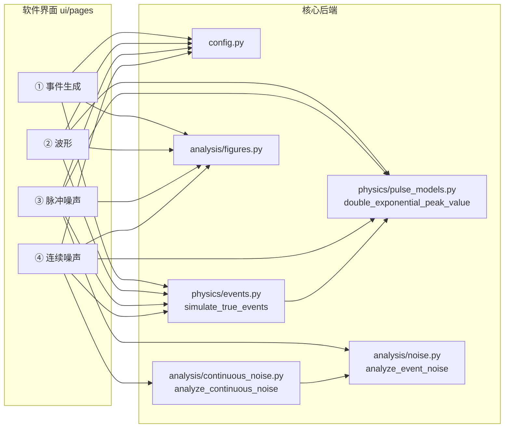

# 核心代码整理清单（test/he3sim/）

> 目的：为后续修改软件功能提供一个**只含「软件实际调用」代码的清晰副本**，与庞大的原仓库分离，便于快速定位。
>
> 整理原则：**只复制、不改动**。`test/he3sim/` 下的每个文件都与 `src/he3sim/` 对应文件**字节级一致**（SHA256 校验通过），原项目代码零改动。

---

## 一、本目录是什么

- 软件 = `src/he3sim/ui/` 的本机 Streamlit 网页（He3Signal 便携版，4 个计算页）。
- 本目录只收纳「这 4 个页面真正调用到的后端核心代码」，共 **28 个文件、约 4600 行**。
- 原仓库 `src/he3sim/` 共有 64 个活动 `.py` 文件；另外 36 个是**命令行 `he3sim` 专属**（合成/采集/IO/标定/各阶段验证），软件界面不依赖它们，**未纳入本目录**（见第四节）。

## 二、目录结构

```text
test/
├── MANIFEST.md                     ← 本清单
└── he3sim/                         ← 核心代码副本（保留原包结构，仅含核心文件）
    ├── config.py                   ← 配置模型（全库共享地基）
    ├── types.py                    ← 结构化数据类型 dtype
    ├── random.py                   ← 固定 seed 随机上下文
    ├── logging.py                  ← 日志
    ├── physics/                    ← 物理内核（真相层）
    │   ├── events.py               ← 总入口 simulate_true_events
    │   ├── arrivals.py             ← 泊松到达
    │   ├── chains.py               ← 裂变链蒙特卡洛
    │   ├── source_model.py         ← 相关中子源模型映射
    │   ├── spectra.py              ← He-3 参数化能谱
    │   ├── amplitude.py            ← 能量→幅值
    │   ├── pulse_models.py         ← 归一化双指数脉冲
    │   ├── pulse_parameters.py     ← 时间常数参数
    │   ├── rate_profiles.py        ← 计数率剖面
    │   └── protocols.py            ← 统一接口协议
    ├── analysis/                   ← 噪声分析（科研核心）
    │   ├── noise.py                ← Rossi-α / Feynman-α / PSD
    │   ├── continuous_noise.py     ← 连续 ACF / VTM / Wiener 去卷积
    │   └── figures.py              ← 配色与绘图函数
    └── ui/                         ← 软件界面（入口 + 4 页）
        ├── app.py                  ← 页面导航
        ├── launcher.py             ← 便携版窗口启动器
        ├── runtime.py              ← 资源路径解析
        ├── offline_dashboard.py    ← 离线 HTML 报告面板
        └── pages/
            ├── 01_event_generation.py
            ├── 02_waveform.py
            ├── 03_phase_b.py
            └── 04_phase_c.py
```

## 三、文件清单

### 3.1 公共地基（4 个）

| 文件 | 行数 | 作用 | 被谁依赖 |
|---|---|---|---|
| `config.py` | 533 | Pydantic 配置模型、参数状态（synthetic_demo/provisional/validated）、配置哈希 | 几乎全库 |
| `types.py` | 220 | `TRUE_EVENT_DTYPE`、`EVENT_LINEAGE_DTYPE` 等结构化 dtype | physics / io |
| `random.py` | 24 | `RandomContext`，按 seed 派生子随机流，保证可复现 | physics |
| `logging.py` | 32 | 结构化日志 | 基础工具 |

### 3.2 物理内核 physics/（10 个 + `__init__.py`）

| 文件 | 行数 | 作用 |
|---|---|---|
| `events.py` | 224 | **核心总入口** `simulate_true_events`：编排到达→能谱→幅值→脉冲参数，产出真值事件表 |
| `arrivals.py` | 104 | 两种精确齐次泊松算法（Poisson-count+sorted-uniform / 累积指数） |
| `chains.py` | 176 | 源驱动纯瞬发裂变链蒙特卡洛（`BranchingChainGenerator`），产出相关中子到达 |
| `source_model.py` | 83 | `PromptSourceModel`：k_eff/α/效率 → 各反应率与探测率的集中推导 |
| `spectra.py` | 137 | `ParametricHe3Spectrum`：764 keV 全能峰 + 壁效应连续区混合能谱 |
| `amplitude.py` | 76 | `LinearAmplitudeMapper`：能量 → 峰值幅值（A_peak = G_E·E + ε） |
| `pulse_models.py` | 90 | 归一化双指数脉冲数学（峰时刻、峰值、核函数） |
| `pulse_parameters.py` | 37 | `FixedPulseParameterProvider`：固定时间常数 τr/τd |
| `rate_profiles.py` | 21 | `ConstantRateProfile`：恒定计数率剖面 |
| `protocols.py` | 49 | `RateProfile` / `EventArrivalGenerator` 等抽象接口 |

### 3.3 噪声分析 analysis/（3 个 + `__init__.py`）

| 文件 | 行数 | 作用 | 被哪页调用 |
|---|---|---|---|
| `noise.py` | 409 | `analyze_event_noise`：Rossi-α / Feynman-α / PSD 三估计器 + 时间块 bootstrap | ③ 脉冲噪声 |
| `continuous_noise.py` | 494 | `analyze_continuous_noise` / `pulse_kernel_samples` / `wiener_deconvolution`：连续 ACF、VTM、去卷积、CCF/CTM | ④ 连续噪声 |
| `figures.py` | 786 | 配色常量 + `_new_figure` + 各阶段绘图（软件只用其中约 30%） | ①~④ 通用 |

### 3.4 软件界面 ui/（8 个 + `__init__.py`）

| 文件 | 行数 | 作用 |
|---|---|---|
| `app.py` | 26 | Streamlit 导航，挂 4 页 |
| `launcher.py` | 169 | 便携版 Tkinter 窗口控制器 + 后台 Streamlit 服务 |
| `runtime.py` | 18 | `resource_path` / `application_root`（源码/冻结双运行） |
| `offline_dashboard.py` | 111 | 由 `he3sim export-dashboard` 调用的离线 HTML 面板 |
| `pages/01_event_generation.py` | 199 | 事件生成与统计（泊松/相关源） |
| `pages/02_waveform.py` | 167 | 连续波形生成 |
| `pages/03_phase_b.py` | 192 | 脉冲模式噪声分析 |
| `pages/04_phase_c.py` | 210 | 连续信号噪声分析 |

## 四、软件调用关系（谁接了什么接口）



**每页实际接口速查：**

| 页面 | 核心接口 | 文件 |
|---|---|---|
| ① 事件生成 | `simulate_true_events` | `physics/events.py` |
| ② 波形 | `simulate_true_events` + `double_exponential_peak_value` | `events.py` + `pulse_models.py` |
| ③ 脉冲噪声 | `simulate_true_events` + `analyze_event_noise` | `events.py` + `analysis/noise.py` |
| ④ 连续噪声 | `simulate_true_events` + `analyze_continuous_noise` | `events.py` + `analysis/continuous_noise.py` |
| ①~④ 通用 | `load_config` / `He3SimConfig` / `SourceModelKind` | `config.py` |
| ①~④ 通用 | 配色 + `_new_figure` + phase_b 图 | `analysis/figures.py` |

## 五、未纳入本目录的代码（原仓库仍保留，软件界面不依赖）

以下模块/文件属于**命令行 `he3sim` 科研批处理专属**，软件界面不调用，故未复制：

- `synthesis/`：真正的波形合成后端（renderers / streaming / digitizer / noise / baseline / dataset）
- `acquisition/`：触发 / 死时间 / 事件匹配
- `io/`：HDF5 / 示波器 / MCNP / DT5800 stub
- `calibration/`：Phase 4Q 数据资格审查
- `analysis/` 中：`phase3_validation.py`、`phase_a_validation.py`、`phase_b_validation.py`、`phase_c_validation.py`、`counting_stats.py`、`pulse_features.py`、`reports.py`、`waveform_plot.py`
- `physics/` 中：`event_stream.py`（流式生成）、`split_detector.py`（双探测器）
- `cli.py`（16 个子命令的统一入口）
- `archive/`：已归档的旧 Web/ML 代码

> ⚠️ 这些**不是死代码**，只是「CLI 专属」。后续若要精简，需单独评估 CLI 是否仍要保留，不要与本目录混删。

## 六、后续整理建议（供修改软件功能时参考）

1. **最高优先**：`pages/02_waveform.py`、`03_phase_b.py`、`04_phase_c.py` 三处各有一份**几乎相同的 numpy 脉冲叠加代码**（`kernel = (exp(-t/τd)-exp(-t/τr))/peak*0.15` + 循环叠加 + 白噪声），且**都没复用 `synthesis/`**。建议抽成一个公共函数（如 `ui/_waveform.py`），消除三处重复。
2. **核心最小集**：真正跑起来软件的是 `physics/`（10 文件）+ `analysis/noise.py` + `analysis/continuous_noise.py` + `config.py` + `types.py` + `random.py`，约 2800 行，是理解软件行为的最小阅读量。
3. **figures.py 偏大**：786 行里软件只用了配色常量、`_new_figure` 和 3 个 `phase_b_*` 图函数，其余是 CLI 各阶段报告图，可考虑拆分成「软件绘图」与「CLI 报告绘图」两块。

## 七、完整性说明

- 本目录 28 个文件与 `src/he3sim/` 对应文件 **SHA256 逐一一致（0 不一致）**。
- 整理过程**未修改 `src/` 任何文件**（`git status --short -- src` 无输出）。
- 本目录是**只读参考副本**，不参与打包、测试或导入（其内部仍保留 `he3sim.*` 导入路径，需放回 `src/he3sim/` 才能运行）。
